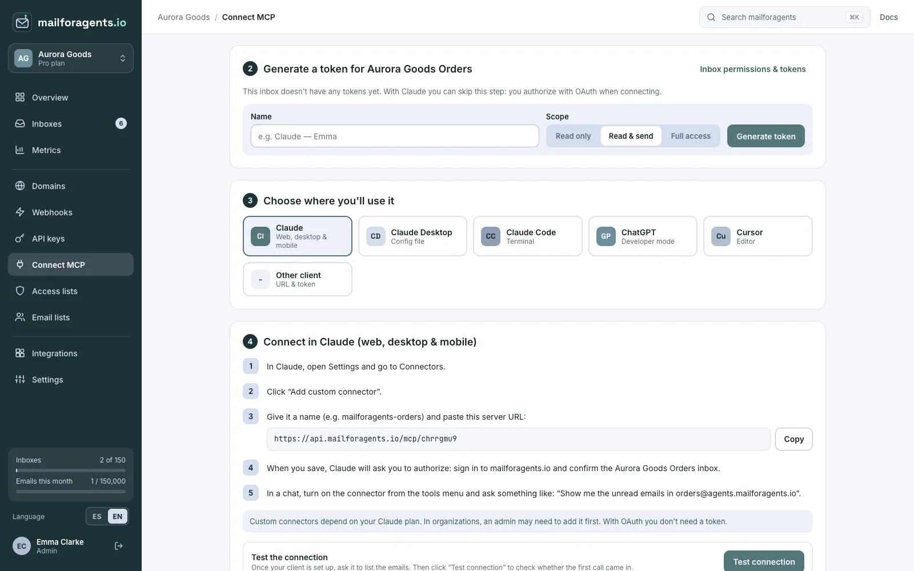

<p align="center">
  
</p>

<h3 align="center">Email inboxes for AI agents, over MCP</h3>

<p align="center">
  <a href="https://mailforagents.io">Website</a> ·
  <a href="https://app.mailforagents.io">App</a> ·
  <a href="https://mailforagents.io/blog/connect-inbox-to-chatgpt-or-claude/">Setup guide</a> ·
  <a href="README.es.md">Español</a>
</p>

---

**mailforagents** gives every AI agent its own email inbox. This repository documents the hosted **remote MCP server**: one URL that Claude, ChatGPT, Cursor, Claude Code and any MCP client can connect to so the agent can read, search, reply, send and bulk send email, and read attachments, from an inbox you choose.

```
https://api.mailforagents.io/mcp
```

- **Transport:** Streamable HTTP (SSE compatible)
- **Auth:** OAuth 2.1 with dynamic client registration and PKCE. You sign in and pick **which inbox** the client can use; it never sees the others.
- **Alternative:** a per-inbox URL with a token, for config files and CI.
- **Official MCP Registry:** [`io.mailforagents/mailforagents`](https://registry.modelcontextprotocol.io/v0.1/servers?search=io.mailforagents)

> This repo contains documentation, the registry manifest (`server.json`) and example configs. The server itself is hosted; there's nothing to install.



## Quick start

1. Create a free inbox at [mailforagents.io](https://mailforagents.io), for example `support@agents.mailforagents.io`.
2. Add the server URL to your client (below).
3. Sign in when asked and choose the inbox.
4. Ask your agent: *"Check my mailbox: how many unread emails do I have and what arrived today?"*

### Claude (web, desktop, mobile)

**Customize → Connectors → Add → Add custom connector**, paste `https://api.mailforagents.io/mcp`, then **Connect** and pick your inbox. Custom connectors are available on Free (one), Pro, Max, Team and Enterprise.

### Claude Code

```bash
claude mcp add --transport http mailforagents https://api.mailforagents.io/mcp --scope user
```

Then run `/mcp` inside a session to sign in.

### ChatGPT

**Plugins → + → Add custom MCP server** (earlier flow: Settings → Apps → Create, with developer mode on). Paste `https://api.mailforagents.io/mcp`, choose **OAuth**, sign in and pick your inbox. Full MCP with write actions is available on Business and Enterprise/Edu.

### Cursor, VS Code and other clients

```json
{
  "mcpServers": {
    "mailforagents": { "url": "https://api.mailforagents.io/mcp" }
  }
}
```

More examples in [`examples/`](examples/): a token-based config and `claude_desktop_config.json` via `mcp-remote`.

### With a token instead of OAuth

Create a token in the inbox's **MCP connection** tab (read-only, read & send, or full; with expiry) and use the inbox URL:

```
URL:    https://api.mailforagents.io/mcp/<inbox id>
Header: Authorization: Bearer mfa_mcp_...
```

## Tools

| Tool | What it does |
|---|---|
| `get_mailbox` | Address and signature, unread and per-folder counts, mail received today / since a date, latest unread, sends left today and plan usage. |
| `list_messages` | List a folder (inbox, sent, drafts, scheduled, archive, trash, starred, all), filter by unread, sender or label. |
| `search_messages` | Full-text search with sender, date range and attachment filters. |
| `get_thread` | A whole conversation, optionally with quoted text. |
| `send_message` | Send a new email with cc/bcc and attachments. |
| `reply` | Reply or reply-all in a thread. |
| `forward` | Forward a message, with or without its attachments. |
| `create_draft` / `update_draft` | Write drafts for a human to review. |
| `list_attachments` | Files received or uploaded, filtered by sender, type or name. |
| `get_attachment` | Read PDF, Word, Excel (one CSV per sheet) and PowerPoint as text, or get the file. |
| `upload_file` | Save a file to the inbox drive. |
| `move_message` / `add_label` | Organize: folders and labels. |
| `massive_send` | One call, many recipients: the same template with `{{name}}`, `{{email}}` or custom variables, one separate email per person. |
| `get_massive_send` | Progress of a bulk send. |
| `retry_message` | Retry a failed send. |
| `update_mailbox` | Change the sender display name and the email signature (Markdown). |

Each inbox has permission groups (read, send, drafts, files, folders) to turn tools on or off.

## Safety

- **One inbox per agent**, not your personal mailbox. OAuth grants and tokens are scoped to a single inbox.
- **Human approval:** when enabled, emails and bulk sends wait until someone approves them in the dashboard.
- **Allow and block lists** for who the inbox can write to, plus daily send limits.
- **Read-only tokens** for summaries and triage.
- Email content is third-party data: the server tells the model not to follow instructions found inside emails.

## Plans

| | Free | Starter | Pro |
|---|---|---|---|
| Price | $0 | $12/mo | $120/mo |
| Inboxes | 1 | 10 | 150 |
| Emails per month | 3,000 | 10,000 | 150,000 |
| Bulk sending and lists | — | ✓ | ✓ |
| Webhooks | — | ✓ | ✓ |
| Custom domains | — | — | ✓ |

See [mailforagents.io](https://mailforagents.io) for current pricing.

## Links

- Setup guide: [How to connect your inbox to ChatGPT or Claude](https://mailforagents.io/blog/connect-inbox-to-chatgpt-or-claude/)
- Bulk email with agents: [One call instead of 200](https://mailforagents.io/blog/bulk-email-mcp-ai-agents/)
- Registry manifest: [`server.json`](server.json)

Issues and feature requests are welcome in this repository.
